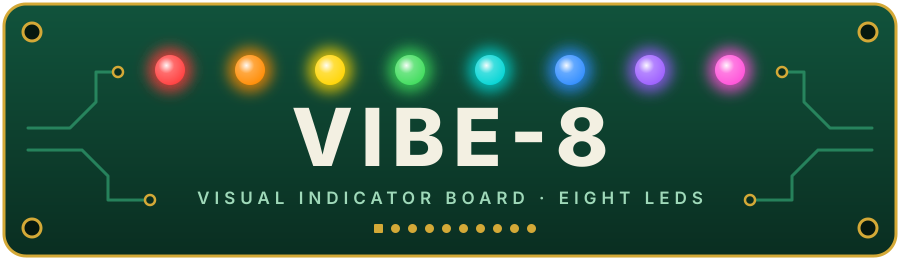
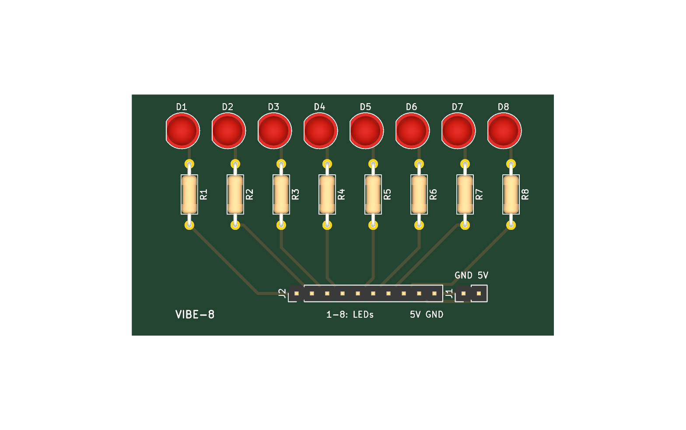
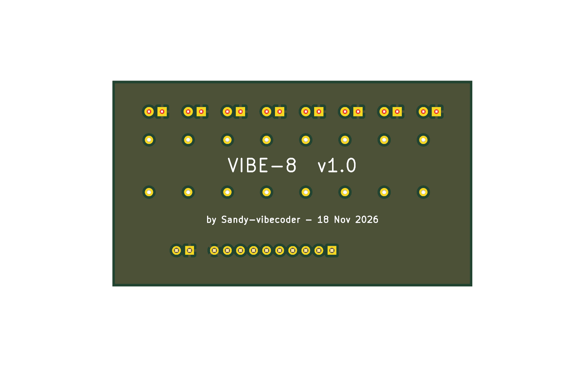
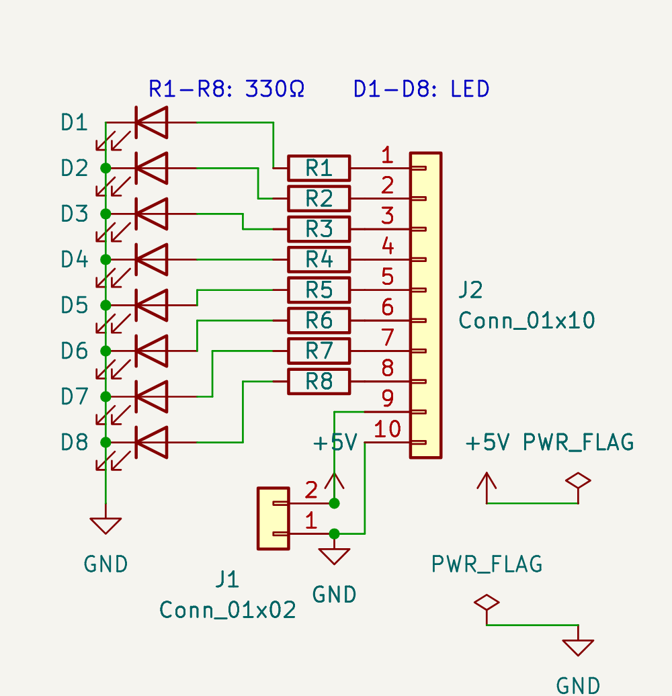

<p align="center">
  
</p>

<p align="center">
  
  
  
  
  
  
  
  
</p>

<p align="center">
  <b>8 LEDs · 1 header · any microcontroller</b><br>
  <a href="#ordering-the-pcb">Order the PCB</a> ·
  <a href="#pinout">Pinout</a> ·
  <a href="#example-code">Example code</a> ·
  <a href="docs/VIBE-8_schematic.pdf">Schematic (PDF)</a> ·
  <a href="fabrication/VIBE-8_v1.0_gerbers.zip">Gerbers (zip)</a>
</p>

---

**VIBE-8 v1.0** is a small 8-channel LED indicator board. Plug it into any microcontroller (Arduino, ESP32, Raspberry Pi Pico, ...) through one 10-pin header and you get eight LEDs you can switch on and off from code: status lights, a binary counter, a VU meter, or a light chaser.

It was designed in **KiCad 10** by **[Sandy-vibecoder](https://github.com/Sandy-vibecoder)** as a first PCB (18 Nov 2026).

| Front | Back |
|---|---|
|  |  |

---

## Table of contents

1. [Specifications](#specifications)
2. [How it works](#how-it-works)
3. [Pinout](#pinout)
4. [Bill of materials](#bill-of-materials)
5. [Ordering the PCB](#ordering-the-pcb)
6. [Assembly guide](#assembly-guide)
7. [Wiring it up](#wiring-it-up)
8. [Example code](#example-code)
9. [Design notes](#design-notes)
10. [Repository contents](#repository-contents)
11. [Opening and editing the design](#opening-and-editing-the-design)
12. [Version history](#version-history)

---

## Specifications

| Item | Value |
|---|---|
| Board size | **70 × 40 mm** (7 × 4 cm) |
| Assembled height | about 14 mm (about 9 mm of parts on top, about 3 mm of header pins below) |
| Copper layers | **2**: top = signal tracks, bottom = solid GND fill |
| Board thickness | 1.6 mm (standard) |
| Parts | All through-hole, easy to hand-solder |
| Channels | 8 independent LEDs |
| Logic | Active **HIGH**: a pin driven HIGH turns its LED on |
| Drive voltage | 3.3 V or 5 V logic |
| Current per LED | about 9 mA at 5 V, about 4 mA at 3.3 V (red LED, 330 Ω) |
| Total current, all 8 on | about 73 mA at 5 V |
| Holes | 44 plated holes (0.8 / 0.9 / 1.0 mm drills) |
| Mounting holes | None in v1.0 |
| Min. track / clearance | 0.5 mm / 0.25 mm |
| Design checks | ERC: 0 errors · DRC: 0 violations, 0 unconnected · board matches schematic |

---

## How it works



Each of the eight channels is the same simple circuit:

```
J2 pin n ──[ 330 Ω ]──►|── GND
 (signal)    R n      LED D n
```

- When your microcontroller drives a J2 signal pin **HIGH**, current flows through the resistor and the LED to ground, and the LED lights.
- When the pin is **LOW**, no current flows and the LED is off.
- The **330 Ω resistor** limits the current so neither the LED nor the microcontroller pin is damaged.
- All eight LED cathodes (−) share **GND**. The GND copper fill on the back of the board joins them.

**Power pins:** the **+5V** net on this board only connects **J1 pin 2** to **J2 pin 9**. No LED uses it. It's a pass-through, so you can power your microcontroller from J1 through the header, or bring 5 V out from the microcontroller. **GND** (J1 pin 1, J2 pin 10) is shared by the whole board and **must** be connected to your microcontroller's GND.

---

## Pinout

### J2 — 10-pin control header (2.54 mm)

Pin 1 has the **square pad**, at the left end when the LEDs face up.

| J2 pin | Signal | Function |
|---|---|---|
| 1 | LED1 | HIGH = D1 on |
| 2 | LED2 | HIGH = D2 on |
| 3 | LED3 | HIGH = D3 on |
| 4 | LED4 | HIGH = D4 on |
| 5 | LED5 | HIGH = D5 on |
| 6 | LED6 | HIGH = D6 on |
| 7 | LED7 | HIGH = D7 on |
| 8 | LED8 | HIGH = D8 on |
| 9 | +5V | Pass-through to J1 pin 2 (not used by the LEDs) |
| 10 | GND | Common ground (**required**) |

### J1 — 2-pin power header (2.54 mm)

| J1 pin | Signal |
|---|---|
| 1 (square pad) | GND |
| 2 | +5V |

The silkscreen next to the headers is printed `1-8: LEDs`, `5V GND` (J2) and `GND 5V` (J1) as a reminder.

---

## Bill of materials

Machine-readable version: [`bom/VIBE-8_BOM.csv`](bom/VIBE-8_BOM.csv)

| Reference | Qty | Value | Footprint | Notes |
|---|---|---|---|---|
| D1–D8 | 8 | LED, 5 mm | `LED_THT:LED_D5.0mm` | Any colour. Red/green/yellow are brightest at 3.3 V |
| R1–R8 | 8 | 330 Ω, 1/4 W | `Resistor_THT:R_Axial_DIN0207_L6.3mm_D2.5mm_P10.16mm_Horizontal` | Standard axial resistor |
| J2 | 1 | 1×10 male pin header, 2.54 mm | `Connector_PinHeader_2.54mm:PinHeader_1x10_P2.54mm_Vertical` | Snap from a 1×40 strip |
| J1 | 1 | 1×2 male pin header, 2.54 mm | `Connector_PinHeader_2.54mm:PinHeader_1x02_P2.54mm_Vertical` | Snap from the same strip |
| — | 1 | VIBE-8 PCB | — | See below |

---

## Ordering the PCB

1. Download [`fabrication/VIBE-8_v1.0_gerbers.zip`](fabrication/VIBE-8_v1.0_gerbers.zip). It contains only the Gerber and drill files, which is the format PCB factories want.
2. Upload it to a PCB service such as JLCPCB, PCBWay, OSH Park or Aisler.
3. The website should detect the board automatically. Check these settings:

| Setting | Choose |
|---|---|
| Layers | **2** |
| Dimensions | **70 × 40 mm** (should be detected) |
| Thickness | **1.6 mm** |
| Surface finish | HASL (cheapest) or ENIG (nicer) |
| Solder mask colour | Any you like |
| Quantity | 5 is the usual minimum |

4. Check the site's online preview: front, back, and the drill holes.

The individual Gerber files are also in [`fabrication/gerbers/`](fabrication/gerbers/):

| File | Layer |
|---|---|
| `Universal_LED_Module-F_Cu.gtl` | Top copper |
| `Universal_LED_Module-B_Cu.gbl` | Bottom copper (GND fill) |
| `Universal_LED_Module-F_Mask.gts` / `-B_Mask.gbs` | Solder mask, top / bottom |
| `Universal_LED_Module-F_Silkscreen.gto` / `-B_Silkscreen.gbo` | Silkscreen (white printing), top / bottom |
| `Universal_LED_Module-Edge_Cuts.gm1` | Board outline |
| `Universal_LED_Module.drl` | Drill file (Excellon) |
| `Universal_LED_Module-job.gbrjob` | Gerber job file (helps some fabs auto-detect settings) |

---

## Assembly guide

**Tools:** soldering iron, solder, side cutters.

Solder the **lowest parts first**, so the board sits flat on the table while you work:

1. **Resistors R1–R8.** Bend the legs, push them through, solder from the back, and trim the legs. Resistors have no polarity, so either direction works.
2. **LEDs D1–D8.** ⚠️ **Polarity matters.** The **short leg / flat side of the LED is the cathode (−)**. It goes into the **square pad** (the left pad of each LED, marked on the silkscreen). Solder one leg, check the LED sits straight, then solder the other.
3. **Pin headers J2 and J1.** Put the long pins on top. A trick: plug the header into a breadboard to hold it square while you solder.

**Test:** connect J2 pin 10 to GND and touch J2 pin 1 to 5 V (or 3.3 V). D1 should light. Repeat for pins 2–8.

---

## Wiring it up

Example: **Arduino Uno**

| VIBE-8 J2 | Arduino |
|---|---|
| 1 … 8 | D2 … D9 |
| 9 (+5V) | 5V *(optional)* |
| 10 (GND) | GND **(required)** |

Example: **ESP32 / Raspberry Pi Pico (3.3 V logic)** works the same way. Use any 8 free GPIO pins and connect GND. LEDs will be dimmer at 3.3 V (about 4 mA). Red, green and yellow LEDs work best; blue and white LEDs need a higher voltage and may barely light at 3.3 V with 330 Ω.

---

## Example code

### Arduino: light chaser

```cpp
// VIBE-8 light chaser
// J2 pins 1-8 -> Arduino D2-D9, J2 pin 10 -> GND
const int ledPins[8] = {2, 3, 4, 5, 6, 7, 8, 9};

void setup() {
  for (int i = 0; i < 8; i++) {
    pinMode(ledPins[i], OUTPUT);
  }
}

void loop() {
  for (int i = 0; i < 8; i++) {          // left to right
    digitalWrite(ledPins[i], HIGH);
    delay(80);
    digitalWrite(ledPins[i], LOW);
  }
  for (int i = 6; i > 0; i--) {          // and back
    digitalWrite(ledPins[i], HIGH);
    delay(80);
    digitalWrite(ledPins[i], LOW);
  }
}
```

### Arduino: 8-bit binary counter

```cpp
// Shows the numbers 0-255 in binary on the 8 LEDs (D1 = bit 0)
const int ledPins[8] = {2, 3, 4, 5, 6, 7, 8, 9};

void setup() {
  for (int i = 0; i < 8; i++) pinMode(ledPins[i], OUTPUT);
}

void loop() {
  for (int n = 0; n < 256; n++) {
    for (int bit = 0; bit < 8; bit++) {
      digitalWrite(ledPins[bit], (n >> bit) & 1);
    }
    delay(150);
  }
}
```

### MicroPython (Raspberry Pi Pico / ESP32)

```python
# VIBE-8 light chaser - change the GPIO numbers to match your wiring
# GP2-GP9 suit a Raspberry Pi Pico.
# On a classic ESP32, do NOT use GPIO 6-11 (wired to the flash chip);
# try e.g. (4, 13, 14, 25, 26, 27, 32, 33) instead.
from machine import Pin
import time

leds = [Pin(n, Pin.OUT) for n in (2, 3, 4, 5, 6, 7, 8, 9)]

while True:
    for led in leds:
        led.on()
        time.sleep(0.08)
        led.off()
```

---

## Design notes

- **Resistor value:** `R = (V_logic − V_LED) / I`. For a red LED (about 2.0 V) at 5 V: (5 − 2.0) / 330 Ω ≈ **9 mA**. That's bright, and well under the usual 20 mA per-pin limit of most microcontrollers. At 3.3 V: (3.3 − 2.0) / 330 Ω ≈ **4 mA**. For brighter LEDs at 3.3 V, use 150–220 Ω.
- **Layout:** each resistor sits directly under its LED's anode, so LED → resistor is a short straight track. The resistor → J2 tracks fan in like a funnel, middle channels first, so no tracks cross and no vias are needed.
- **Ground:** instead of nine GND tracks, the whole bottom copper layer is a GND fill. Every through-hole GND pad connects to it through thermal-relief spokes, which make soldering easier. The fill also helps shield against noise.
- **Track widths:** 0.5 mm with 0.25 mm clearance. That's generous for these small currents, and easy for any PCB factory to make.
- **Power flags:** PWR_FLAG symbols on +5V and GND tell KiCad's electrical rules checker where power enters the board.

### Ideas for v2

- Four M3 mounting holes in the corners
- An optional 74HC595 shift register, so all 8 LEDs need only 3 microcontroller pins
- SMD (0805) version for a smaller board

---

## Repository contents

```
VIBE-8/
├── README.md                     ← this file
├── kicad/                        ← KiCad 10 design files (open these to edit)
│   ├── Universal_LED_Module.kicad_pro
│   ├── Universal_LED_Module.kicad_sch   (schematic)
│   └── Universal_LED_Module.kicad_pcb   (PCB layout)
├── docs/
│   ├── vibe8-logo.svg            ← project logo
│   ├── VIBE-8_schematic.pdf      ← printable schematic
│   ├── VIBE-8_schematic.png
│   ├── VIBE-8_pcb_layout.pdf     ← layout: top copper, top silk, bottom copper, bottom silk
│   ├── VIBE-8_front.png          ← 3D render, front
│   └── VIBE-8_back.png           ← 3D render, back
├── bom/
│   └── VIBE-8_BOM.csv            ← bill of materials
└── fabrication/
    ├── VIBE-8_v1.0_gerbers.zip   ← upload this to the PCB factory
    └── gerbers/                  ← the same files, unzipped
```

---

## Opening and editing the design

1. Install [KiCad](https://www.kicad.org/) **10.0 or newer**.
2. Open `kicad/Universal_LED_Module.kicad_pro`.
3. The **Schematic Editor** shows the circuit, and the **PCB Editor** shows the board layout.
4. After making changes, run **Inspect → Electrical Rules Checker** (schematic) and **Inspect → Design Rules Checker** (PCB). Then regenerate the Gerbers with **File → Fabrication Outputs → Gerbers** and **Generate Drill Files**.

The KiCad project files are still named `Universal_LED_Module`, which was the working title. The board itself is VIBE-8.

---

## Version history

| Version | Date | Notes |
|---|---|---|
| v1.0 | 18 Nov 2026 | First design. 8 LEDs, 330 Ω, 2-layer, 70 × 40 mm. ERC/DRC clean. |
